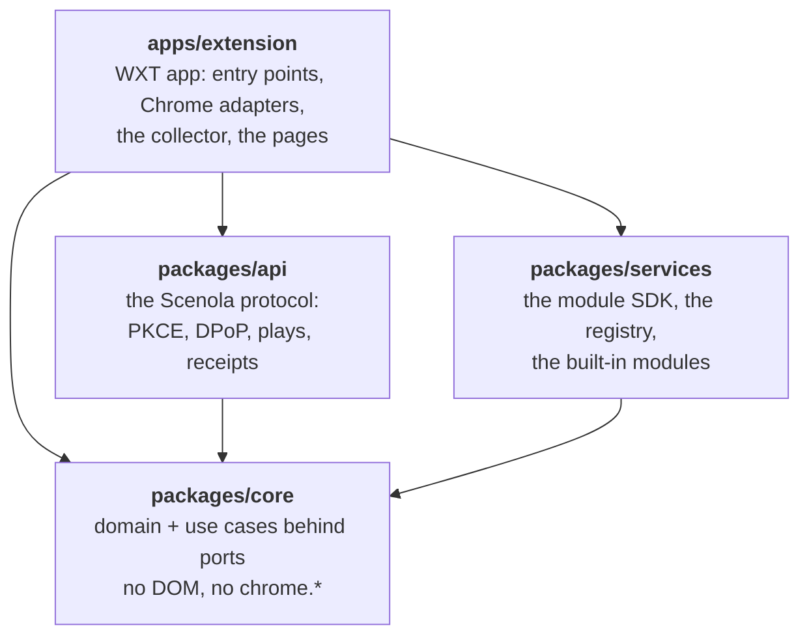
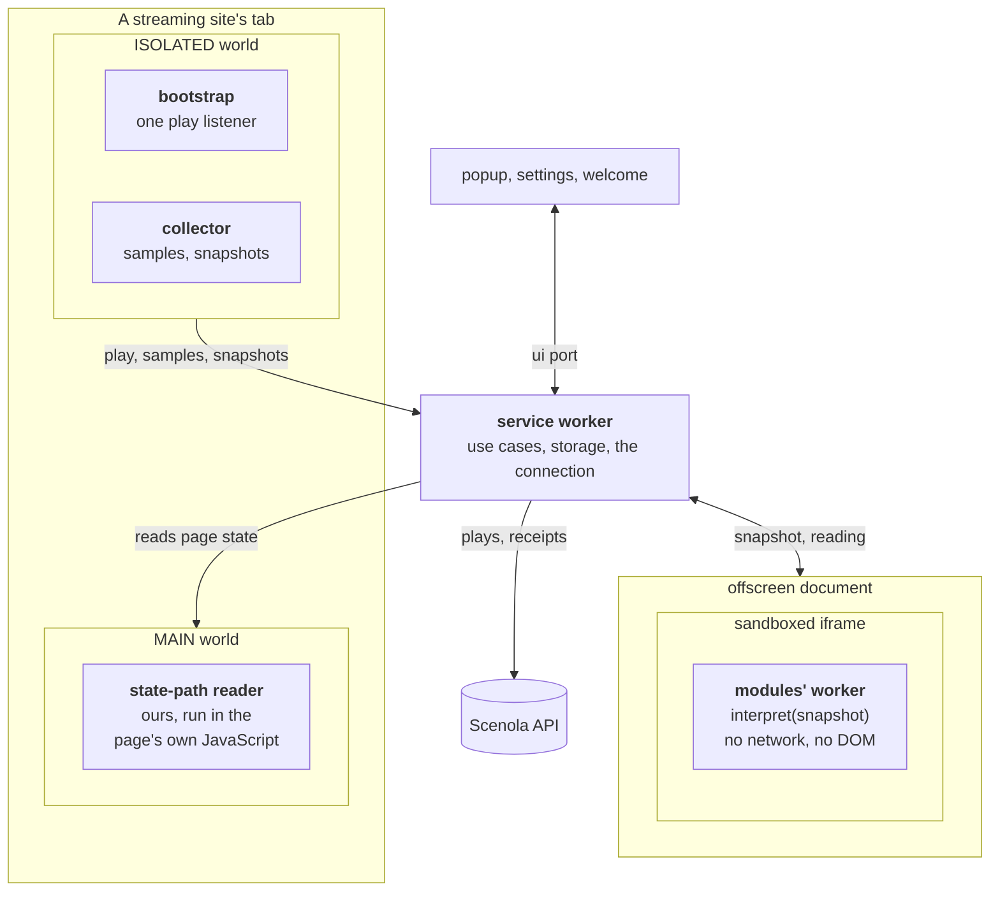
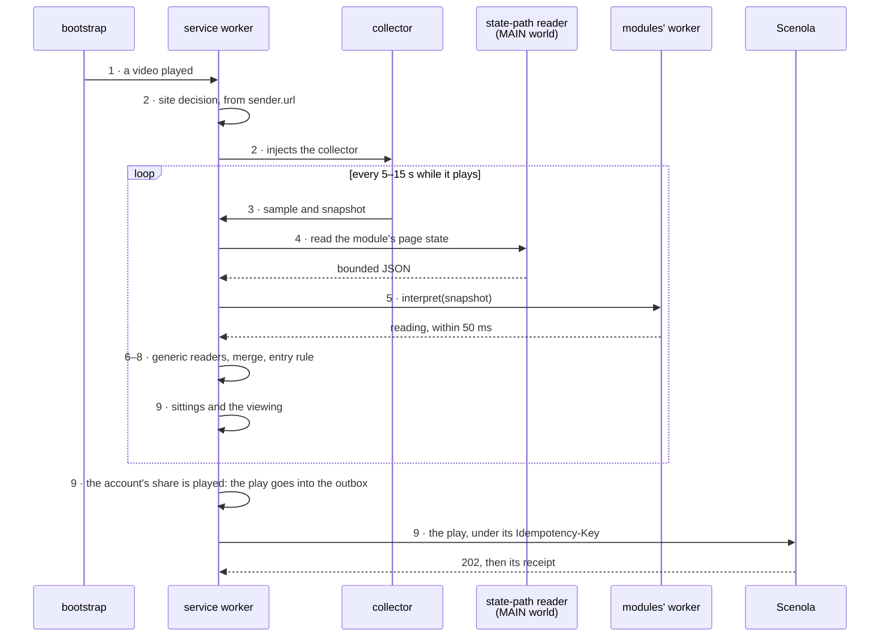

# Architecture

How the Scenola extension is put together, and the rules that keep it that way. A rule marked
**Rule** is one a change must respect; each carries its reason, so an argument with it belongs in
an issue, not in a pull request that works around it.

## The shape

- **Hexagonal.** A pure core — the domain and the use cases — depends on nothing. The browser,
  the network and storage are adapters behind ports; every port has a Chrome implementation and
  an in-memory one for tests, so the rules run in Node with no browser.
- **One edit point per rule.** The finish rule, the play constructor, the service registry, the
  message protocol and the block list each exist once, and a test fails if a second appears.
- **Boundaries are enforced, not hoped for.** Package dependencies point inward, held by
  dependency-cruiser and per-package `tsconfig` files. Where a boundary is a security boundary —
  contributor-written service code — it is a separate realm (a worker of a sandboxed page), not a
  lint rule.
- **The extension reports evidence; Scenola decides.** **Rule:** nothing in the extension
  identifies a title. A play carries what the page stated, and the server's one matching ladder
  decides which title it was, whether it is a repeat and whether to ask the person. A second
  matcher here would disagree with the server's and would need catalogue data the connection
  cannot read. So a service id is sent only when the page states it, never computed or looked up,
  and no catalogue data (posters, Scenola titles) ever enters the extension.

## Packages

An arrow is an import, and imports only point down: `api` and `services` never import each
other, and nothing under `packages/` imports `apps/`.

- **`packages/core`**: coverage, sittings and viewings, the account's lines, the play, receipts,
  the outbox, the status, the label grammar, the generic readers, the block list, the use cases
  and their ports. Compiled with `lib: ["ES2023"]` and no types: `document`, `fetch` and
  `chrome` do not exist there.
- **`packages/api`**: the API types generated from the committed OpenAPI subset, PKCE, keys,
  DPoP proofs, the transport, the token exchange and the plays gateway. `fetch` and WebCrypto
  only, so another browser can reuse it.
- **`packages/services`**: `defineService` and the SDK's types, the helpers a module may use,
  the registry of built-in sites, and one folder per module.
- **`apps/extension`**: the manifest and the build, the service worker, the content scripts and
  the collector, the offscreen document and the sandbox, the popup, welcome and settings pages,
  and the Chrome adapters. The only package that knows `chrome`.
- **`tools/`**: the mock API, the OpenAPI subset, the i18n compiler, the icon renderer, the
  release tools, the scaffold, the generated docs and the gates.

The rules are named in `.dependency-cruiser.cjs` (`core-is-pure`, `core-no-chrome`, `api-only-core`,
`services-only-core`, `runtime-takes-no-module-code`, `only-the-sandbox-starts-its-worker`,
`runtime-takes-no-build-code`, `pages-take-no-protocol`, the two `no-unresolvable-in-*` rules,
`no-circular`). `tools/gates/boundaries.test.ts` proves that the four layer rules,
`no-unresolvable-in-packages` and the two rules that keep module code in the sandbox's worker
still fire. A bare `chrome` or `window` in core is refused by ESLint (`tools/lint/core-purity.js`),
since dependency-cruiser sees imports, not globals. If `services` ever needs a type from `api`,
move the type to `core`; do not open the edge.

## Files and folders

The same shape everywhere, so a reader can guess where a thing is and what a file holds without
opening every one.

- **A folder per layer, a file per idea.** A module and its test sit side by side (`viewing.ts`,
  `viewing.test.ts`), and a folder stays flat until one unit needs more than a file. That unit
  then becomes a folder named for it, with `index.ts` as its public face and its parts beside it
  (`domain/labels/`, `domain/generic-readers/`, `application/ingest-observation/`,
  `composition/ui-requests/`); its importers keep their path. The tools run under plain Node
  with explicit `.ts` imports, so a tool that grows splits into sibling files instead
  (`tools/mock-api/`, `tools/i18n/icu.ts`).
- **A module only tests import is named `test-*.ts`** (`test-world.ts`, `test-harness.ts`,
  `test-client.ts`). A test file grown too long to read is split by subject, its shared set-up
  moved into such a module (`composition/root-*.test.ts`).
- **The readability budget** (`tools/lint/readability.js`). ESLint warns past a complexity of 20,
  a nesting depth of 4, 5 parameters, callbacks nested 4 deep, a function of 120 lines and a file
  of 500 (1,200 for a test), counting neither blank lines nor comments. Warnings, so a change can
  land and be split after; in CI each one is an annotation on its line
  (`tools/lint/formatter.js`). **Rule:** a function or file past the budget is split, and the
  budget is not raised to fit it. A file is excused only for a reason the code cannot change,
  written beside its entry, as `collector/state-path-reader.ts` is: Chrome runs it in the page
  as one self-contained function.

## How a page is read

Where each piece runs. Every box is a separate realm: only the service worker holds the
connection, and only the modules' worker runs contributor-written code.

One play, from the first `play` to Scenola's answer. The numbers are the steps below.

**Rule:** no contributor-written code runs in a streaming site's page, in a content script or in
the service worker. Everything that touches a page is ours and generic; a module is data plus one
pure function.

1. **The bootstrap** (≤ 2 KB) is declared for the built-in hosts and registered at run time for
   the sites a person allows. It adds one capture-phase `play` listener and nothing else, so
   nothing runs on a page until a video plays. On install, update or a new grant, the worker also
   injects it into tabs already open, which Chrome would otherwise leave without one; injected
   where a video already plays in the tab in view (_Track this site_ pressed while it plays), it
   asks at once, since no `play` will come.
2. **The site decision.** On the first `play` the worker decides from Chrome's `sender.url`,
   never from the message, in this order: blocked (YouTube, russian domains — whatever was
   allowed), excluded by the person, a built-in service (unless turned off), an allowed site or
   all sites on, else not tracked. Incognito tabs are then refused unless the person allowed
   them. A tracked tab gets the **collector**, injected with `scripting.executeScript`. There
   are no `web_accessible_resources` and the bootstrap and the collector live in the isolated
   world, so a page cannot find the extension by its files or its scripts. The one thing a page
   can notice is step 4: a module's state reads run in the page's own JavaScript, where the page
   can watch its objects being read — on that module's own service, on a player route, after a
   video plays.
3. **The collector** elects the main video, samples it every 15 s and on media events, and every
   5 s while playing (and on navigation) builds a **snapshot**: exactly what the site's module
   declared in `collect`, plus the generic readers' inputs, bounded. One message per sample.
4. **Page state** a module declared is read by our state-path reader, which the worker runs in
   the page's MAIN world, only on one of the module's player routes. It walks the declared path,
   calls only the zero-argument methods `ALLOWED_CALL_NAMES` lists for that module (a call can do
   anything the page's code can, so each name is reviewed), never runs the page's `JSON` or
   `toJSON`, and clones the result to bounded JSON (depth ≤ 6, ≤ 32 KB).
5. **Interpretation** — the module's `interpret(snapshot)` — runs in a dedicated worker of a
   sandboxed page, inside an offscreen document that exists only while snapshots arrive. An
   answer after 50 ms is discarded; the service worker validates it (valibot, bounded) and marks
   every field as the module's.
6. **The generic readers** run in the worker on every snapshot, in order of trust: JSON-LD,
   Media Session, Open Graph, the document title (through the label grammar, which reads
   `S1 E2`, `Folge 3`, `第3集` and the like), and last the **address reader**, which reads only a
   season and an episode from the frame's path, query or hash (`season-1/episode-2`, `s1e2`,
   `1x02`, `?season=1&episode=2`, in many languages' words) — exactly one pair, or nothing.
7. **Merging.** Per field, the module's value wins; else the highest confidence. **Rule:** when
   the site's module answered, the generic readers fill no field that says which item plays —
   kind, titles, numbers, years, ids, the stated length. A JSON-LD block left over from an
   in-app navigation is about the previous item, and filling a module's gaps from it gave
   episode 2 the numbers of episode 1. Moment signals (`contentEnded`, `adPlaying`) still flow.
8. **The entry rule.** On a site without a module, a viewing starts only when the page says it
   is a film or an episode: JSON-LD `Movie` or `TVEpisode`, Open Graph `video.movie` or
   `video.episode`, a season-and-episode label, or a page that says it is a series and whose
   address names exactly one episode. A page that says none of these is not tracked, and the
   popup says why. On a site with a module, only a frame on a declared player route may name a
   viewing.
9. **`IngestObservation`** turns the samples and the merged reading into sittings and viewings
   (below); **`ReportViewing`** puts a play in the **outbox** before any network call; and
   **`DrainOutbox`** and **`RefreshReceipts`** talk to Scenola.

**Messages** are one protocol (`apps/extension/src/messaging/protocol.ts`): a versioned
discriminated union, validated with valibot on arrival. The worker accepts a content message
only from its own extension id and a tab.

**State** is in IndexedDB and written at most once per tab per sample. The worker can stop
between any two awaits and resumes from storage.

## The viewing model

The extension decides, without help, whether a person watched something. A wrong play is a wrong
diary entry and a privacy cost; a missed one can be marked by hand. Every rule below leans that
way, and is a pure function over plain data in `packages/core/src/domain/viewing.ts` and
`coverage.ts`.

- **A viewing** is one watching of one thing, across as many sittings as it took: sittings join
  while none is more than 7 days after the last. An idle viewing is dropped unsent.
- **Identity** (`viewingKey`): the service's own title id when the module states one; else show,
  season and episode; else film title and year — under the service's id when a module read them,
  so two services never share a viewing. A reading that names another identity (autoplay into
  the next episode) starts a new viewing. No kind or no identifier: the viewing never reports.
  A later reading of the same viewing keeps the earlier values of the fields it lacks.
- **Coverage, not position.** Between two samples, a span counts as played only when both were
  playing and ad-free, the wall-clock gap is under 75 s and the position moved no more than
  `rate × elapsed × 1.5 + 1 s`. A larger jump is a seek or a sleep and adds nothing, so scrubbing
  to the last scene plays almost nothing. Nothing counts from a paused or ended sample.
- **The story** runs from the end of the intro to the start of the credits: the intro end and
  credits start a module states; else one skipped intro (a forward seek early in the content);
  else the position where the service's credits or post-play screen first showed; else an
  estimate of `duration − min(12 %, 20 min)`. Long end titles never hold a viewing back, and
  skipped time is never played.
- **The length** is the module's statement when it gives one (not under 120 s), else the largest
  element length two consecutive samples agreed on. Without a length there is no story, and
  nothing is sent.
- **Not content.** Media under 120 s is ad time: it adds no coverage, ends nothing and opens
  nothing. A muted element never starts a viewing (autoplay previews and trailers are muted). An
  ad the sample or the module reports adds no coverage and ends nothing.
- **The account's lines.** The person sets them in Scenola, for every connected service, and
  the extension reads them with the connection check: a **finish line** of 50, 70 or 90 % (70
  while none was read), and an optional **start line** for films (a share and a floor in
  seconds; off by default). Both are drawn on the numbers the play sends:
  `played_seconds ≥ ceil(line × story_seconds / 100)`. The server counts by the same line, so
  what is sent is what it counts.
- **One play per viewing.** In the observation where the story seconds played first reach the
  finish line, mid-story or not, the play is queued with that observation's numbers and its
  sample's time as `watched_at`. The viewing is then closed: watching on, or rewatching the last
  scene in a later sitting, sends nothing more. A film whose account saves starts sends one
  **start** when it passes the start line, a subset of the same fields, at most once per viewing.
- **`ended`** says only that the title played out — the element's own `ended` (from media whose
  length is the viewing's) or the service's credits or post-play signal — at the moment the play
  was queued. It is never the extension's estimate, and never "my own rule says this counts".
  **Rule for modules:** a next-episode or post-play screen must declare `contentEnded`, even when
  it names the next title; the end belongs to the media still playing.
- The person's **Skip** in the popup means this viewing is never reported.

## The outbox, receipts and _Waiting for you_

**Before any network call.** A play is built by `buildPlay`, the only constructor, and written to
the outbox under a fresh UUIDv7, which is its `Idempotency-Key`. The report is three writes —
reserve the id on the viewing, add the entry if absent, close the viewing — ordered so that a
worker stopped between any two neither loses the play nor makes it two, and a body never changes
under its key. The use cases that read and write viewings run under one FIFO lock
(`ViewingLock`), so two observations of one viewing cannot become two plays.

**Rule: nothing leaves but the documented fields.** A play carries its kind, `watched_at` with
the local offset, the playback numbers (duration, furthest position, `story_seconds`,
`played_seconds`, `ended`), the film's or episode's title and year, for an episode the show and
its numbers, and ids only as the page stated them. Never a URL, a host, a page title, an account
or profile name. Values outside the server's bounds are dropped before sending, and an episode
without its show's title or either number is not built at all. [privacy.md](privacy.md) is the
inventory; a new field changes it, the About screen and the store listing in the same release.

**Draining.** `DrainOutbox` sends due entries one at a time, oldest first, only while connected,
with a one-minute watchdog alarm while the outbox is not empty. Nothing about an entry changes
until an answer arrives, and the history is written before the entry is removed. The answers
(`outboxStep`, a pure table):

| Answer                                      | The outbox does                                                      |
| ------------------------------------------- | -------------------------------------------------------------------- |
| `202`                                       | done; keep the answer; slide the expiry estimate; read at +10 s      |
| `202` with no `scrobble_id`                 | done; the answer is final (a `not_completed` asks for a fresh check) |
| `409 already_applied`                       | done                                                                 |
| `409 in_flight`                             | retry in 30 s                                                        |
| `429`                                       | retry after `retry_after_seconds`                                    |
| `5xx`, network error, timeout, a throw      | backoff 1, 2, 5, 15, 60 min, then every 6 h, ±10 % jitter            |
| `401 credential_invalid`                    | pause every entry, mark the connection broken                        |
| `404` in the server's envelope              | the feature is closed: retry in 6 h                                  |
| `422`, `413`, another `4xx` in the envelope | dead letter, never retried                                           |
| a `4xx` without the envelope                | backoff, as a `5xx`                                                  |
| any retry past `watched_at` + 29 days       | dead letter (`too_old`)                                              |

Only the server's own refusal, in its error envelope, is a dead letter: a proxy's or a CDN's
`403` judged nothing about the play, and must not lose every queued play.

**Receipts** are read on a schedule, close together while an answer is likely: at +10 s, +1 min,
+5 min and +15 min after sending, then hourly through the first day and every 6 hours after,
and whenever the popup opens (every play still waiting, the newest 20, at most once a minute
each), four at a time, until the play settles or 30 days pass. The server decides within seconds, its own backstop within minutes when that is late, so
a play does not sit at _Sent_ long enough to look lost. A `404` in the envelope ends tracking
for that play ("no longer tracked"). A receipt is display
only: nothing in the extension decides from it, and a state it has not seen renders as an
unknown, unsettled answer.

**_Waiting for you_** in the popup lists the plays Scenola is asking the person about
(`needs_confirmation`, `held`). Plays one answer settles share the receipt's opaque
`question_key` and show as one row, labelled from the extension's own plays ("Show · S1 E2–E6"),
linking to the question in the web app. **_Recently_** lists the last plays and starts with the
server's verdict in words, and each opens **_What was sent_**: the exact body that left the
browser, when, and the answer.

## The connection

**Sign-in is PKCE plus DPoP.** The connection's key is ECDSA P-256, generated non-extractable
with the one usage `sign`, once per connection, and stored as a `CryptoKeyPair` in the
extension's IndexedDB — neither our code, a content script nor a console can read the private
half out. Sign-in opens the web app's approval page with `chrome.identity.launchWebAuthFlow`,
carrying the PKCE challenge, a `state` and the key's thumbprint (`dpop_jkt`); the returned code
is traded, with a proof, for a credential bound to the key. A leaked credential is useless
without the key. One flow runs at a time, and a worker stopped mid-flow leaves the connection as
it was: the credential and the key are written in one put.

- **Proofs** are signed for every request with a fresh `jti`, `htu` from the configured API base,
  and `ath` over the credential. Every input the server checks is checked first: a proof the
  server would refuse is never signed. The server's latest `DPoP-Nonce` is kept in
  `chrome.storage.session`; a nonce refusal is retried exactly once, with the nonce that answer
  handed over.
- **No refresh token.** Each stored play moves the server's sliding expiry, so each `202` moves
  the local estimate; the icon warns 14 days before. The server's `401` is the truth.
- **Reconnect only when needed**: on `401 credential_invalid` or when the key is gone. Each
  connection counts against the account's limit until it expires.
- **Personal tokens**, for self-builds only: the backend redirects a sign-in only to the
  extension ids it lists, so a fork can paste a personal token instead (a bearer, no DPoP). Store
  builds ship without that strategy, and the build checks it is absent.

**The account key.** A browser can change hands: a broken connection is mended by whoever signs
in next. So the connection check (`GET /v1/integrations/connection`, when a page opens and when
the worker starts, at most once a minute) answers an opaque `account_key`, the same for every
connection of one account. Every outbox entry, history entry and viewing is stamped with it.
**Rule:** nothing is sent and no receipt is read until the current connection's key is read, and
then only records carrying that key; after a new connection, whatever carries another key or none
is deleted, never sent. The key is compared whole, never parsed, logged, shown or exported, and
lives only in the connection's IndexedDB record, never in what a page receives.

**Disconnect** removes the account from the browser, not only its credential: the credential and
the key, the plays not sent yet, the history, every viewing and tab state, the account's lines
and last check, and the diagnostics log. The settings, which belong to the browser, stay. The
person is asked first, with the count of unsent plays, and may send them first (at most 10 s).
The removal is marked in the same transaction that deletes the credential, so a worker stopped
half-way finishes it at its next start, and before any new sign-in. Plays already sent stay in
the account; the web app's _Connected services_ removes the connection on the server.

## Ports and use cases

The core's ports are `packages/core/src/application/ports.ts`; their in-memory implementations,
for tests, are `packages/core/src/application/testing/in-memory.ts`.

| Port             | Chrome implementation (`apps/extension/src/platform/`)                    | For                                         |
| ---------------- | ------------------------------------------------------------------------- | ------------------------------------------- |
| `Clock`, `Ids`   | `systemClock`, `cryptoIds` (UUIDv7) — `clock.ts`                          | testable time and ids                       |
| `ViewingStore`   | `IdbViewingStore` — IndexedDB                                             | open viewings, their sittings, tab state    |
| `Outbox`         | `IdbOutbox` — IndexedDB                                                   | plays waiting to be sent                    |
| `PlayHistory`    | `IdbPlayHistory` — IndexedDB                                              | what was sent and answered, 1, 7 or 30 days |
| `PlaysGateway`   | `packages/api`'s plays gateway over `fetch`                               | send a play, read its receipt               |
| `ConnectionRepo` | `IdbConnectionRepo` — IndexedDB                                           | the connection, its token and its key       |
| `AuthStrategy`   | `ChromePkceDpopAuth`, `PersonalTokenAuth` (self-builds), `TestAuth` (e2e) | how a connection is made                    |
| `Interpreter`    | the offscreen document's sandbox                                          | run a module's `interpret(snapshot)`        |
| `Scheduler`      | `AlarmScheduler` — `chrome.alarms`                                        | wake-ups for the outbox, receipts, expiry   |
| `StatusDisplay`  | `ActionStatusDisplay` — `chrome.action`                                   | icon, badge, tooltip                        |
| `Settings`       | `ChromeSettings` — `chrome.storage.local`, versioned                      | preferences                                 |
| `Diagnostics`    | `IdbDiagnostics` — IndexedDB ring buffer                                  | the local diagnostics log's retention       |

The app adds ports only its composition root knows (`apps/extension/src/composition/ports.ts`):
`CollectorInjector` and `PageStateReader` (`scripting.executeScript`), `TabsInfo`, and the app's
views of the scheduler and the settings. `SitePermissions` (`chrome.permissions` and
`chrome.scripting.registerContentScripts`) decides which sites are tracked. `packages/api`
defines `RequestSigner` (a DPoP or a bearer signer) and `NonceStore`.

Each use case is a class in `packages/core/src/application/` with its ports in the constructor
and one public method; the composition root (`apps/extension/src/composition/root.ts`) is the
only place that constructs them.

| Use case            | Does                                                                 |
| ------------------- | -------------------------------------------------------------------- |
| `IngestObservation` | a tab's sample and readings → sittings, viewings, the report trigger |
| `ReportViewing`     | a viewing at the finish line → its play → the outbox                 |
| `SkipViewing`       | the person's _Skip_: the viewing is never reported                   |
| `DrainOutbox`       | sends what is due, with backoff, and gives up at 29 days             |
| `RefreshReceipts`   | reads receipts at +10 s, +1, +5 and +15 min, then hourly             |
| `Connect`           | runs an `AuthStrategy` and stores the connection                     |
| `Disconnect`        | forgets the connection and its key, then all the account left here   |
| `ConfirmAccount`    | the check's `account_key` → keeps only that account's records        |
| `PauseTracking`     | pauses until a time, or until turned back on                         |
| `ExpireStale`       | closes idle viewings and prunes history and diagnostics              |

The toolbar's state is one function of everything else (`packages/core/src/domain/status.ts`),
so every surface says the same thing; core owns message keys, the app owns the words.

## The registry as build-time data

`packages/services/src/registry.ts` is the single edit point for the built-in sites. Importing it
runs every module's file, so only two things may: the **build**, and the **sandbox's worker**
(`apps/extension/src/entrypoints/sandbox/interpret-worker.ts`), where module code runs. The
sandbox holds against a malicious module only while that stays true:
`runtime-takes-no-module-code` refuses the import anywhere else in the extension, the sandbox
page included, and `only-the-sandbox-starts-its-worker` refuses the worker's file to anything but
the sandbox page, which starts it as a worker.

- At build time, `apps/extension/build/sites-data.ts` imports the registry in Node and emits
  plain JSON: each site's id, name and hosts, and for each module the build ships its version,
  verification, player routes (as source and flags), collect spec and allowed calls, with the
  SDK's caps. Which modules ship is `modulesForBuild` for the build's mode and day — a store
  build ships only modules verified in the last 90 days; the day is `SOURCE_DATE_EPOCH`'s when
  set, so a rebuild picks the same modules.
- `wxt.config.ts` inlines that JSON as one constant; `apps/extension/src/sites.ts` reads it and
  compiles the routes once. The worker, the content scripts and the pages read the registry only
  through it, enforced by `runtime-takes-no-module-code` and `runtime-takes-no-build-code`.
- The manifest's host permissions and content-script matches are generated from the same
  registry. All seven built-in hosts are in the first release, modules or not, because a host
  added later disables the extension until the person accepts it.
- Player routes are data that runs in the worker, so the SDK refuses catastrophic ones
  (stateful flags, backreferences, nested variable repeats) and they never run on a pathname over
  2,048 characters. A module never calls the service's own endpoints: it reads what the page
  already loaded.
- [services.md](services.md) is generated from the registry too (`pnpm docs:services`).

## The security model

- **Permissions:** `storage`, `identity`, `alarms`, `scripting`, `offscreen` and `activeTab` —
  no `tabs`, no `webRequest`. Host permissions are the built-in hosts and the API origin;
  `https://*/*` and `http://*/*` are optional, requested only from the person's click. No
  `web_accessible_resources`, no `externally_connectable`: no page or other extension can message
  the worker or find the extension by its files. A page can notice it only where a module reads
  that page's own state (_How a page is read_, steps 2 and 4).
- **Content Security Policy** of the pages and the worker:
  `script-src 'self'; object-src 'none'; base-uri 'none'; require-trusted-types-for 'script'; connect-src 'self' <api origin>; img-src 'self' data:; font-src 'self'; style-src 'self'; frame-src 'self'`.
  No remote code, no `eval`, no inline script; `fetch` reaches the API and the extension's own
  files only; Trusted Types make a string assigned to `innerHTML` throw.
- **The sandbox** (`sandbox allow-scripts; default-src 'none'; script-src 'self'; worker-src blob:`)
  is a unique origin with no network, no `chrome.*`, no storage and no page, and the modules run
  in a dedicated worker it starts from a `blob:` address, which inherits that policy. A page's
  policy does not close every way out of it, which is why no module runs in one:
  - a `<link rel="dns-prefetch">` or `rel="preconnect"` looks a name up before any policy is
    asked, so code with a document could spell a snapshot into a host name. The worker has no
    document; its `fetch`, sockets, `EventSource` and `importScripts` answer to the policy.
  - WebRTC's STUN and TURN requests reach past any policy. The worker has no WebRTC, and the
    sandbox page deletes every `RTC*` global as it loads; a frame appended to the page is another
    opaque origin, whose fresh globals the page cannot read.
  - a policy governs what a page loads, not where its frame navigates: the pages'
    `frame-src 'self'` keeps the frame on the extension's pages, Chrome refuses an opaque
    origin's way to any of them, and the frame's own `sandbox="allow-scripts"` keeps sandboxed
    whatever it reaches.

  `apps/extension/e2e/sandbox.spec.ts` tries each way out, watching a STUN server that counts
  what reaches it and Chromium's own network log for the names it looked up. The lint rules on
  module files (no globals but a few, no `eval`, no computed member access, no `as any`) catch
  accidents; they are not the boundary, and say so.

- **Storage placement:** the token and the non-extractable key in IndexedDB, which no page or
  content script can open; `chrome.storage.local` holds settings only and is set to trusted
  contexts at every start; `chrome.storage.session` holds what may be lost (the DPoP nonce, a
  sign-in in progress). Diagnostics pass one scrubber and never take titles, URLs or page text.
- **No analytics, telemetry, crash reports or third parties.** The only network peer is the
  configured Scenola API.
- **The store build's checks** (`apps/extension/build/manifest.ts`, `config-rules.ts`,
  `output-check.ts`): the manifest's permissions and policy are checked after it is written; a
  store build needs public `https:` origins and PKCE sign-in only, carries no development key, no
  `<all_urls>`, no personal-token or test sign-in, no pseudo-locale; and the output may not name
  the workspace or the builder's home.
- **Reproducible builds.** The inputs are the commit, the lockfile, Node and pnpm (pinned) and
  `SOURCE_DATE_EPOCH`. Every build is a production build; CI builds twice, from two checkouts in
  two directories, and compares the files byte for byte. The release zip
  (`tools/release/deterministic-zip.ts`) has sorted entries, fixed times and modes, and is read
  back. The **fingerprint** (`tools/release/fingerprint.ts`) is a SHA-256 over every `.js`,
  `.css` and `.html` file by path, shown in Settings → About; `pnpm verify:install` checks an
  installed copy against it and the zip. Releases carry a build-provenance attestation.
- **Supply chain:** exact pins, a seven-day minimum release age, install scripts only by name
  (`pnpm-workspace.yaml`), CI actions pinned by commit, read-only workflow tokens, no store
  credential in CI — the store accepts only packages signed with a key kept offline. Dependabot
  proposes updates to the pins once they are seven days old (`.github/dependabot.yml`), and
  CodeQL analyses the code and the workflows on every pull request (`.github/workflows/codeql.yml`).

How to report a vulnerability: [SECURITY.md](../SECURITY.md).

## Where data lives

- **IndexedDB, in the extension's origin:** open viewings and tab state, the outbox, the history,
  diagnostics, and the connection — its token, its key pair and its account key.
- **`chrome.storage.local`:** settings and the account's lines as last read.
- **`chrome.storage.session`** (memory only): the server's latest DPoP nonce and a sign-in in
  progress.

## Languages and accessibility

Text comes from ICU messages in `apps/extension/src/i18n/messages/en.json`, compiled at build
time into one module per locale and loaded on demand (`pnpm i18n:check` guards them). Only
English ships today; the pipeline takes the web app's 32 locales (`tools/i18n/locales-map.ts`)
as their catalogs arrive. Dates go through `Intl`, and logical CSS properties let right-to-left
languages mirror. Every surface meets WCAG 2.2 AA: keyboard-reachable controls with a visible
focus ring, state always in words (never colour or the badge alone), reduced motion honoured,
contrast checked in CI (`pnpm contrast:check`), and every page's tests run an axe audit.

## Dependencies

Runtime: `preact`, `@preact/signals`, `valibot` and `idb`, nothing else — Preact rather than
React for the popup's first-paint and size budget. A fifth runtime dependency is proposed in an
issue first. Two font packages ship too, as files rather than code: the pages' typefaces,
`@fontsource-variable/bricolage-grotesque` and `@fontsource-variable/instrument-sans` (SIL Open
Font License), bundled so no page loads a font from the network. Every build writes
`THIRD_PARTY_NOTICES.txt` beside its code (`apps/extension/build/notices.ts`): each package it
ships, read from the bundles, with its licence's text — the package's own file, or, for an MIT
package that publishes none, MIT's standard text under its declared author; Settings → About
opens it. Everything
else is a development tool, pinned exactly and at least seven days old when installed; each has
its line here.

| Tool                                        | Why                                                    |
| ------------------------------------------- | ------------------------------------------------------ |
| `wxt`, `vite`                               | the extension's build, its manifest and its dev server |
| `tailwindcss`, `@tailwindcss/postcss`       | the pages' styles, compiled at build time              |
| `typescript`, `@types/node`                 | the language and Node's types for the tools            |
| `eslint`, `@eslint/js`, `typescript-eslint` | lint, the MPL notice rule, the modules' guard rails    |
| `prettier`                                  | formatting; the generators format their output with it |
| `dependency-cruiser`                        | the package boundaries                                 |
| `knip`                                      | unused files, exports and dependencies                 |
| `vitest`, `fast-check`                      | the tests, and property-based ones                     |
| `happy-dom`                                 | the DOM the pages' and the collector's tests run in    |
| `@testing-library/preact`                   | renders a page in a test and finds what a person would |
| `fake-indexeddb`                            | IndexedDB in Node, for the stores' tests               |
| `axe-core`                                  | the accessibility audit each page's tests run          |
| `@playwright/test`                          | the end-to-end tests: the built extension in Chromium  |
| `jose`                                      | verifies DPoP proofs in tests and in the mock API      |
| `openapi-typescript`                        | the API types from the committed OpenAPI subset        |
| `@formatjs/icu-messageformat-parser`        | compiles the ICU messages at build time                |
| `@resvg/resvg-js`                           | renders the toolbar icons from SVG at build time       |
| `size-limit`, `@size-limit/file`            | the size budgets                                       |

The release zip, the installed-copy check, the scaffold and the generated docs use Node's own
modules (`node:zlib`, `node:crypto`, `node:module`'s resolve hook) and no dependency. Lint and
format run over the files git tracks or would track (`tools/lint/git-files.js`), so nothing
else in a checkout's folder is touched.
